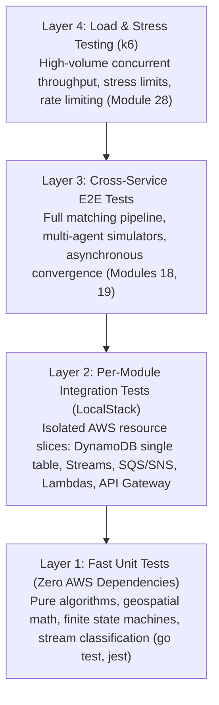

# Testing Strategy & Verification Architecture

This document defines the comprehensive testing strategy for the cloud-native ride-dispatch platform across its multi-language microservices (Go, TypeScript, Terraform).

---

## The Testing Pyramid

The platform enforces a four-layer testing pyramid designed to catch regressions early, validate isolated infrastructure components against emulated cloud resources, and verify complex asynchronous distributed workflows under realistic synthetic traffic.

---

### Layer 1: Pure Unit Tests (Zero AWS Dependencies)

- **Target:** Core mathematical algorithms, geospatial computations, business state machines, stream record classification, and assignment orchestration logic.
- **Execution Speed:** Sub-second to few seconds; zero external network or container dependencies.
- **Tools:** `go test -race -v -cover` for Go services; `jest` across npm workspaces for TypeScript.
- **Key Modules & Packages:**
  - `shared/geospatial`: Geohash encoding, 8-neighbor bounding calculation, Haversine spherical distance.
  - `shared/matching-algorithms`: Candidate scoring, ranking, distance weighting.
  - `services/event-forwarder/internal/classify`: Pure classification and routing of DynamoDB Stream images to domain SQS payloads.
  - `services/matching-service/internal/geoindex`: Thread-safe RWMutex spatial index with concurrent upserts/queries.
  - `services/matching-service/internal/assignment`: Two-phase claim-then-confirm assignment, conditional DynamoDB state transitions, and compensating rollback logic tested via mock interfaces (`DynamoWriter`, `TripServiceClient`).
  - `services/trip-service/src/domain/ride-state-machine`: Strict transition rules (`REQUESTED` $\rightarrow$ `MATCHED`, etc.) and cancellation invariant validation.

---

### Layer 2: Per-Module Integration Tests (LocalStack)

- **Target:** Individual infrastructure components and microservices running against real AWS API implementations emulated by LocalStack.
- **Execution Pattern:** Standalone shell scripts in `tests/integration/<module>-test.sh`. Each script is idempotent, self-contained, and tests a single vertical slice.
- **Tools:** Bash, AWS CLI (`awslocal` / `aws --endpoint-url`), Terraform local state, curl, Node.js JWT signing utilities.
- **Active Test Suites:**
  1. `dynamodb-schema-test.sh`: Validates single-table creation, partition/sort keys, and GSIs (`GSI1`, `GSI2`, `GSI3`).
  2. `shared/dynamo-client/go` & `ts`: Integration tests for conditional writes, optimistic concurrency guards, and attribute mapping.
  3. `location-service-test.sh`: Deployed custom Go runtime Lambda handlers, API Gateway routes, JWT authorizer, and driver location/status mutations.
  4. `trip-service-test.sh`: Deployed TypeScript Lambda handlers, rider ride lifecycle transitions, cancellation conflict handling (`409 Conflict`), and internal driver assignment.
  5. `sqs-sns-infra-test.sh`: Dead-letter queue (DLQ) redrive policies, visibility timeouts, and SNS topic fan-out.
  6. `event-forwarder-test.sh`: End-to-end DynamoDB Streams $\rightarrow$ forwarder Lambda $\rightarrow$ SQS queue routing (`location-events`, `ride-request-events`).

---

### Layer 3: Cross-Service End-to-End Tests

- **Target:** Full asynchronous distributed pipeline executing across multiple services simultaneously. Validates that real-time location telemetry flowing through Location Service, DynamoDB Streams, and SQS correctly pairs with incoming ride requests in Trip Service.
- **Active Test Suites:**
  1. `matching-service-e2e-test.sh` (Module 18):
     - **Role:** Fast, deterministic smoke test.
     - **Scope:** Single driver + single rider. Confirms that a single location ping populates the Matching Service `GeoIndex` and successfully matches a subsequent ride request, transitioning it to `MATCHED`.
  2. `e2e-naive-flow-test.sh` (Module 19):
     - **Role:** Full multi-agent stochastic verification.
     - **Scope:** Runs both `@ride-dispatch/driver-simulator` and `@ride-dispatch/rider-simulator` concurrently against the live platform for a configurable duration (`RUN_DURATION_SECONDS`).
     - **Metrics & Reporting:** Aggregates all rides generated during the run, computes the match success rate (`matched / total`) and average time-to-match, asserting that performance exceeds `MIN_MATCH_SUCCESS_RATE` (default: 50%).

---

### Layer 4: Load & Stress Testing (Module 28, Future)

- **Target:** High-throughput load generation, rate limiting, connection pooling, and DynamoDB partition throttling under heavy concurrency.
- **Tooling:** [k6](https://k6.io/) distributed load testing scripts.
- **Focus:** System resilience, p95/p99 latency degradation under load, and concurrency race resolution rather than algorithmic match quality.

---

## Guidelines for Adding Tests for New Modules

When introducing new services or capabilities (e.g. Module 20 Notification Service, Module 23 Batch Matcher, Module 27 State Reconciliation):

| Component / Layer | Where to Add Tests | Requirements |
| :--- | :--- | :--- |
| **New Domain Logic / Algorithms** | `<service>/internal/...` or `shared/...` | Pure unit tests (`_test.go` or `.test.ts`). Must pass `go test -race` or `npm test` with no external dependencies. Aim for >85% statement coverage. |
| **New AWS Infrastructure Slice** | `tests/integration/<module>-test.sh` | Bash script deploying and exercising the isolated Terraform module against LocalStack. Must run cleanly in CI before tear-down. |
| **New Asynchronous Workflow** | Update or expand Layer 3 E2E tests | Ensure the end-to-end pipeline accounts for the new event subscriber (e.g., verifying that Notification Service receives SNS match notifications). |
